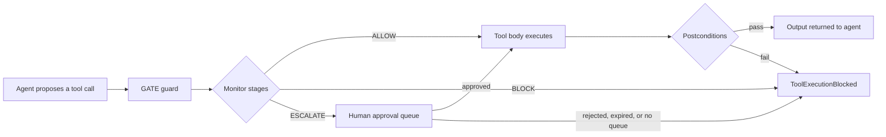

# GATE: Runtime Security Guardrails for LLM Agents

**Validate every guarded tool call before it executes. Keep your agent loop.**

[](LICENSE)
[](https://www.python.org/downloads/)
[](CHANGELOG.md)
[](tests/)
[](#supported-frameworks)
[](CHANGELOG.md)

GATE (Guarded Agent Tool Execution) is a zero-trust runtime security layer for LLM agents. It wraps an existing agent framework, intercepts every guarded tool call at the dispatch boundary, and returns `ALLOW`, `BLOCK`, or `ESCALATE` before the tool body runs. The planner, the graph, and the tools stay as they are; only the dispatch of the tools GATE can see is mediated.

It works with **LangChain**, **LangGraph**, the **OpenAI Agents SDK**, and **CrewAI**, with the same policy and decision model in every framework.

> GATE is a policy-enforcement layer, not a sandbox. Read the [security model](docs/security-model.md) for the guarantees, assumptions, and known gaps before using it in a production path.

## Table of contents

- [Why GATE](#why-gate)
- [How it works](#how-it-works)
- [Security stages](#security-stages)
- [Supported frameworks](#supported-frameworks)
- [Install](#install)
- [Quick start](#quick-start)
- [Guarantees and limits](#guarantees-and-limits)
- [Documentation](#documentation)
- [Tests](#tests)
- [Citation](#citation)
- [Contributing](#contributing)
- [License](#license)

## Why GATE

Agent frameworks are good at running tools and bad at policing them. A prompt injection, a hallucinated argument, or a runaway loop can turn a helpful agent into an action that deletes records, leaks data, or sends a message it should not have.

GATE moves the security decision to the one place every tool action must pass through: the dispatch boundary.

- **Framework-native.** Wrap the agent you already have. No DSL, no loop rewrite, no proxy in front of the model.
- **Decision before side effects.** A guarded tool body runs only after `ALLOW` or explicit human approval.
- **Three outcomes.** `ALLOW`, `BLOCK`, or `ESCALATE`; escalations go to a human queue instead of being silently allowed.
- **Defense in depth.** Five configurable stages: privilege, DFA supervision, smart contracts, semantic firewall, and a discrete control barrier function (D-CBF).
- **Fails closed.** An unexpected stage error is a denial, not a pass, and a failed postcondition withholds the output.
- **Tested as a framework component.** 59 tests, including real dispatch paths for all four frameworks, with no API key or network required.

Typical places it fits:

- **Customer-support agents** that can issue refunds, change records, or send email.
- **Coding agents** that run shell commands, edit files, or open pull requests.
- **Research agents** that browse, fetch, and write to storage.
- **Operations agents** that call infrastructure APIs.

GATE does not make these agents safe on its own. It gives you one enforcement point for the policy you define, and a structured `ValidationResult` you can log.

## How it works

GATE installs a guard on the live tool objects the framework already dispatches to. For every guarded call the guard:

1. marshals the framework's native arguments into a `ToolCall`;
2. advances the execution state machine;
3. awaits `monitor.validate_action`, which runs the enabled stages in order and short-circuits on the first failure;
4. dispatches only on `ALLOW`;
5. after execution, calls `monitor.validate_result` and withholds the output if a contract postcondition fails.



| Decision | What happens |
|---|---|
| `ALLOW` | The call proceeds to the original tool body unchanged. |
| `BLOCK` | The call is refused and `ToolExecutionBlocked` is raised with the `ValidationResult` attached. |
| `ESCALATE` | The call is withheld and routed to an approval queue. With no queue configured, it stays withheld. |

## Security stages

The default configuration enables all five stages. They run in a fixed order and the first denial wins.

| Stage | Key | What it checks | Docs |
|---|---|---|---|
| Privilege | `privilege` | Tool allow-list, data scope, and resource budget. | [Privilege](docs/stages/privilege.md) |
| DFA supervision | `dfa` | Execution phases, legal transitions, step and loop budgets. | [DFA supervision](docs/stages/dfa.md) |
| Smart contracts | `contracts` | Preconditions before dispatch and postconditions after execution. | [Smart contracts](docs/stages/contracts.md) |
| Semantic firewall | `semantic` | Semantic drift from the run's intent anchor and known harm prototypes. | [Semantic firewall](docs/stages/semantic-firewall.md) |
| D-CBF monitor | `dcbf` | Discrete control barrier functions over the agent state. | [D-CBF monitor](docs/stages/dcbf.md) |

The quick-start example enables only the deterministic stages so it runs without downloading an embedding model.

## Supported frameworks

| Framework | `wrap_agent` key | Adapter | Extra | Guarded dispatch path |
|---|---|---|---|---|
| LangChain | `langchain` | `LangChainAdapter` | `langchain` | Compiled agent graph or `AgentExecutor` tool dispatch |
| LangGraph | `langgraph` | `LangGraphAdapter` | `langgraph` | `ToolNode` |
| OpenAI Agents SDK | `openai-agents` | `OpenAIAgentsAdapter` | `openai-agents` | `FunctionTool.on_invoke_tool` |
| CrewAI | `crewai` | `CrewAIAdapter` | `crewai` | Function-call dispatch table |

Only tools the adapter can see are mediated. Pass `tools=[...]` explicitly for tools in nested graphs, and assert that each expected tool carries `_gate_enforcement`.

## Install

Python 3.9 or newer. The distribution is named `GATE-security`; the import package is `gate`.

```bash
git clone https://github.com/CharafeddineMechalikh/GATE.git
cd GATE
python -m venv .venv
source .venv/bin/activate   # Windows: .venv\Scripts\activate
pip install -e ".[all,dev]"
```

Use one extra instead of `all` when you only need one framework, for example `pip install -e ".[langgraph,dev]"`. Until the first PyPI release, install from source as shown above.

## Quick start

```python
from gate import AgentProfile, ResourceBudget, gateConfig, wrap_agent

config = gateConfig(
    agent_profile=AgentProfile(
        agent_id="research-agent",
        role="analyst",
        allowed_tools={"search"},
        resource_budget=ResourceBudget(max_steps=20, max_loops_per_phase=5),
    ),
    enabled_checks={"privilege", "dfa"},
)

# graph is a compiled LangGraph whose tools run in a ToolNode.
secure = wrap_agent(graph, "langgraph", config)
result = secure.invoke({"messages": [...]})
```

`wrap_agent` accepts a compiled LangGraph, a LangChain agent or graph, an OpenAI Agents `Agent`, or a CrewAI `Crew`. The same configuration works with every framework; only the framework key changes:

```python
secure = wrap_agent(graph, "langgraph", config)
secure = wrap_agent(agent, "langchain", config)
secure = wrap_agent(agent, "openai-agents", config)
secure = wrap_agent(crew, "crewai", config)
```

The full end-to-end scenario in each framework, including keyless drivers, is in [Framework scenarios](docs/framework-scenarios.md).

## Guarantees and limits

For a guarded call that reaches the guard, GATE guarantees:

1. **No body before a decision.** The original tool body runs only after `ALLOW` or an approved escalation.
2. **First denial wins.** Stages run in a fixed order and stop at the first refusal.
3. **Postconditions withhold output.** A failed postcondition raises `ToolExecutionBlocked(post_execution=True)` and the output never reaches the agent.
4. **Semantic errors fail closed.** A scoring or embedding error becomes a `BLOCK`.
5. **Escalation requires approval.** An escalated call is never dispatched silently.

What GATE is **not**:

- **Not a sandbox.** It assumes the Python process, dependencies, and tool code are not compromised.
- **Not complete mediation by default.** Tools the adapter never receives, or raw callables invoked directly, bypass the guard.
- **Not a prompt-injection cure.** Stage checks are heuristics; pair them with least privilege, strict contracts, narrow tools, and human review.
- **Not transactional.** A postcondition can hide a result but cannot roll back a sent email or a committed write.
- **Not a cancellation guarantee.** Timeouts stop waiting, not necessarily the work already running.

Read [Security model](docs/security-model.md) for the full threat model and [deployment guidance](docs/security-model.md#deployment-guidance).

## Documentation

Full documentation lives in [`docs/`](docs/README.md):

- [Installation](docs/installation.md): requirements, extras, verified framework versions.
- [Quick start](docs/quickstart.md): a guarded agent, block handling, approvals, audit.
- [Framework scenarios](docs/framework-scenarios.md): the same policy and scenario in LangGraph, LangChain, OpenAI Agents, and CrewAI.
- [Architecture](docs/architecture.md) and [Enforcement plumbing](docs/enforcement.md): how a call reaches the monitor and how guards are installed.
- [Security stages](docs/stages/privilege.md): privilege, DFA, contracts, semantic firewall, and D-CBF.
- [Framework adapters](docs/adapters/README.md): what complete mediation means for each framework.
- [Human-in-the-loop](docs/human-in-the-loop.md) and [Audit](docs/audit.md): approvals, SLA, encrypted audit log.
- [Security model](docs/security-model.md): guarantees, known gaps, and deployment guidance.
- [API reference](docs/api-reference.md), [Configuration](docs/configuration.md), and [FAQ](docs/faq.md).

## Tests

```bash
python -m pytest tests/ -q
python -m pytest tests/test_framework_adapters.py -v
```

The framework integration suite builds real framework objects and drives each framework's native dispatch path: LangGraph `ToolNode`, LangChain's compiled agent graph, OpenAI's `FunctionTool.on_invoke_tool`, and CrewAI's function-call dispatch table. No model, API key, or network access is needed.

## Citation

If GATE supports your research, please cite it.

**Please cite us as:** *to be specified soon.*

The accompanying manuscript is under review; this section and [`CITATION.cff`](CITATION.cff) will be updated with the final reference. Until then, please cite the software.

Plain text:

> Mechalikh, C. (2026). *GATE: A Zero-Trust Runtime Reference Monitor for LLM Agent Frameworks* (Version 1.0.0) [Computer software]. https://github.com/CharafeddineMechalikh/GATE

BibTeX:

```bibtex
@misc{mechalikh_gate_2026,
  author       = {Mechalikh, Charafeddine},
  title        = {{GATE}: A Zero-Trust Runtime Reference Monitor for {LLM} Agent Frameworks},
  year         = {2026},
  howpublished = {\url{https://github.com/CharafeddineMechalikh/GATE}},
  note         = {Version 1.0.0, Apache-2.0 license}
}
```

GitHub's **Cite this repository** button reads [`CITATION.cff`](CITATION.cff).

## Contributing

Issues and pull requests are welcome. Before opening a pull request, run `python -m pytest tests/ -q` and describe which framework dispatch path your change touches. If you find a bypass, use the private reporting flow in [`SECURITY.md`](SECURITY.md) rather than a public issue.

If GATE is useful to you, a star helps other agent developers find it.

## License

Licensed under the [Apache License 2.0](LICENSE).

## Scope

This repository contains the runtime framework, its adapters, and their tests. The evaluation harness, benchmark data, and manuscript are maintained separately.
