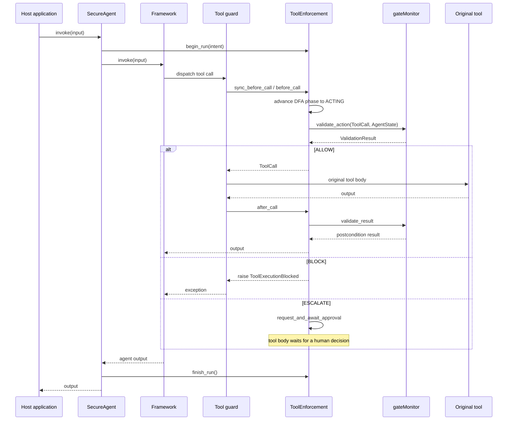

# Architecture

GATE is a reference monitor placed at the tool-dispatch boundary of an agent framework. The framework still owns planning, prompting, and the agent loop. GATE owns the question "may this tool body run, and may its output reach the agent?"

## Components

```text
                    host application
                           |
                    SecureAgent wrapper
                           |
              +------------+-------------+
              |                          |
        ToolEnforcement              framework object
        (run state, decisions)       (graph / executor / crew)
              |                          |
        gateMonitor --------------> guarded tool objects
              |
   +----------+-----------+----------+-----------+
   |          |           |          |           |
Privilege   DFA     Smart contracts  Semantic   D-CBF
enforcer  supervisor   registry      firewall   monitor
```

| Component | Module | Responsibility |
|---|---|---|
| `SecureAgent` | `gate.adapters.*` | Framework-specific wrapper returned by `wrap_agent`; starts and finishes each run |
| `ToolEnforcement` | `gate/adapters/enforcement.py` | Per-run state, guard installation, sync/async bridging, HITL routing |
| `gateMonitor` | `gate/core/monitor.py` | Runs the enabled stages in order and reduces them to a `ValidationResult` |
| `DefaultPrivilegeEnforcer` | `gate/security/privilege_enforcer.py` | Tool allow-list, data scope, cost estimate |
| `DefaultDFASupervisor` | `gate/security/dfa_supervisor.py` | Execution-phase transitions, step and loop budgets |
| `ContractRegistry` | `gate/security/smart_contracts.py` | Exact-name contract lookup; preconditions and postconditions |
| `DefaultSemanticFirewall` | `gate/security/semantic_firewall.py` | Embedding-based safety score and ternary decision |
| `EnhancedDCBFMonitor` | `gate/security/dcbf_monitor.py` | Barrier functions and forward-invariance checks |
| `HumanApprovalQueue` | `gate/security/hitl_queue.py` | Withholds escalated calls until a human resolves them |
| `EncryptedAuditLogger` | `gate/audit/encrypted_logger.py` | PII-masked, encrypted event log (opt-in) |

## Request lifecycle



The guard is installed on the live tool object, not on a copy. A `ToolNode`, `AgentExecutor`, CrewAI dispatch table, or `FunctionTool` callback that already holds a reference to the tool therefore sees the guard without being rebuilt. This is what makes the guarantee "every call through this tool object is mediated" rather than "every call through the wrapper object I handed you is mediated".

## Validation order

`gateMonitor.validate_action` runs stages in this order and returns on the first denial:

1. **Privilege**: is this agent allowed to call this tool, touch this data resource, and spend this estimated cost?
2. **DFA**: is a tool call legal in the current execution phase, and are the step and loop budgets intact?
3. **Contracts**: do the tool's registered preconditions hold?
4. **Semantic**: is the action text semantically close to harm and far from intent?
5. **D-CBF**: does the proposed transition keep every barrier inside the safe set?

The order is deliberate. Cheap deterministic checks run before the embedding-based check, and any stage can veto without consulting later stages. A semantic `ESCALATE` returns immediately and does not run the D-CBF stage; the action is withheld pending approval regardless of its barrier state.

## Decision semantics

| Result | `is_allowed` | `escalated` | Guard behavior |
|---|---|---|---|
| ALLOW | `True` | `False` | Dispatch the original tool |
| BLOCK | `False` | `False` | Raise `ToolExecutionBlocked` before dispatch |
| ESCALATE | `False` | `True` | Await human approval; dispatch only if approved |

A `ValidationResult` records `checks_passed` and `checks_failed` as stage names. An escalation is not a stage failure, so `checks_failed` is empty for a semantic escalation; use `escalated` and `semantic_score` to identify it.

## Run state

Each `ToolEnforcement` owns one `AgentState`. `begin_run(intent)` replaces the state, resets the finished flag, and sets the semantic intent anchor when a firewall is present. Every guarded tool shares this state, so step counts, tool history, and phase are consistent across tools in one run.

| Field | Updated by | Meaning |
|---|---|---|
| `current_phase` | Guard and `finish_run` | DFA phase |
| `step_count` | `after_call` | Number of executed tool calls |
| `loop_count["ACTING"]` | Guard on an ACTING self-loop | Consecutive tool calls without returning to planning |
| `tool_history` | `after_call` | Executed calls, in order |
| `resource_usage.api_calls` | `after_call` | Incremented by one per executed call |
| `resource_usage.cost_usd` | Nothing in the adapter path | Stays zero; see [Privilege](stages/privilege.md) |

The DFA phases are `IDLE`, `PLANNING`, `ACTING`, `OBSERVING`, and `ANSWERING`, with `REJECTED` and `EXHAUSTED` reserved as terminal states. The guard advances `IDLE`/`OBSERVING` to `PLANNING` and then `ACTING` before asking the monitor; it records `ACTING` self-loops for the loop budget; `after_call` sets `OBSERVING`; `finish_run` sets `ANSWERING`, after which any further tool call is refused and marked with stage `dfa`.

The guard advances the phase before validation so that the DFA stage evaluates the state the action would execute in, not the stale state that the framework did not update. If the DFA refuses a hop, the guard raises before the monitor runs.

## Concurrency

The monitor API is async. Most framework tool hooks are synchronous, so `ToolEnforcement` creates one dedicated daemon event loop per wrapped agent (thread name `gate-monitor-<id>`) and submits monitor coroutines to it with `asyncio.run_coroutine_threadsafe`. This matters for two reasons:

- HITL approval events and D-CBF history stay on one loop across calls. A fresh `asyncio.run` per call would create a new event loop and break the waiter that an approver thread is trying to resolve.
- Sync and async framework paths share the same run state and the same loop, so a mixed graph does not produce split-brain phase tracking.

`before_call`/`after_call` hold a re-entrant lock around state mutation. The monitor itself is stateful (trajectory tracker, D-CBF history) and is not designed for two concurrent runs of the same wrapped agent. Wrap one agent instance per concurrent run, or serialize runs.

Async frameworks (`ainvoke`, OpenAI `invoke`) call `before_call`/`after_call` directly on the caller's loop, without the bridging thread.

## Failure semantics

GATE is fail-closed at the dispatch boundary, but the failure modes differ by stage:

| Failure | Result |
|---|---|
| Privilege, DFA, or contract precondition denies | `ValidationResult(is_allowed=False)`; guard raises `ToolExecutionBlocked` |
| Semantic score is in the block band | `ValidationResult(is_allowed=False)` with the score attached |
| Semantic scoring raises an error | The firewall returns a BLOCK score with `details["error"]`; the guard refuses the call |
| Postcondition returns false or raises | The output is withheld; guard raises `ToolExecutionBlocked(post_execution=True)` |
| D-CBF barrier check denies | `ValidationResult(is_allowed=False)`; guard raises |
| Unexpected exception inside privilege/DFA/contracts/D-CBF | The exception propagates out of `validate_action` and prevents dispatch; it is not converted to a `ValidationResult` |
| Monitor decision exceeds caller patience | The sync bridge surfaces a timeout; no tool body has run |
| Approval queue absent, full, expired, or rejecting | Escalated call is denied |

The last two rows are the important operational distinction. A monitor exception still prevents dispatch, because it occurs before the original tool call, but it will not look like a normal denial. Host code that catches only `ToolExecutionBlocked` should also catch `Exception`, stop the run, and treat the monitor as unavailable rather than retrying the tool.

Postconditions are different: the side effect has already happened. A failed postcondition withholds the result from the agent; it does not roll back the write, the email, or the HTTP request. See [Smart contracts](stages/contracts.md).

## Timeouts

`SecureAgent.invoke` runs the framework call under `gateConfig.timeout_seconds`. On POSIX in the main thread this uses `SIGALRM`. In a non-main thread, in an async context, or on Windows, it uses a worker thread and waits up to the deadline. A timeout raises the adapter's `TimeoutError` after calling `enforcement.abort(reason)`, which marks the run finished and denies later tool calls. Python cannot kill the worker thread, so the framework call may continue running in the background on those platforms.

Tool-level monitor calls have no separate timeout in the adapter path. A stalled approval blocks the tool call until the queue's SLA expires.

## Complete mediation boundary

GATE mediates exactly the tool objects it was able to guard:

- LangGraph: tools registered on a `ToolNode` discovered in the compiled graph, or an explicit `tools=` list.
- LangChain: `.tools` on an executor, tools discovered on graph `ToolNode`s, or an explicit `tools=` list.
- OpenAI Agents SDK: every `FunctionTool` on the wrapped agent and all reachable handoff targets; MCP servers and hosted tools cause the wrap to be refused.
- CrewAI: tools attached to the crew's agents and tasks.

Anything else is outside the boundary. Tools created after wrapping, tools hidden inside a nested graph that does not expose a `ToolNode`, and tools the adapter was not told about run unguarded. This is a limitation of a wrapper that does not replace the framework's execution engine; it is documented per adapter and in the [security model](security-model.md).

## Related pages

- [Enforcement plumbing](enforcement.md) for the guard API and custom adapters.
- [Adapters](adapters/README.md) for per-framework discovery rules.
- [Security model](security-model.md) for the threat model and deployment guidance.
