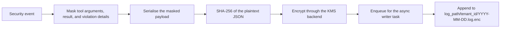

# Audit logging

The encrypted audit logger records security decisions and violations as PII-masked, encrypted JSON lines, partitioned by tenant and date. It is optional and is not attached by the framework adapters.

## Important: adapters do not enable audit

`gateConfig.audit_log_path` is declared but unused. Each adapter constructs `gateMonitor(config)` without an `audit_logger`, and `wrap_agent` exposes no logger argument. In the adapter path, no audit events are written, including blocks and escalations.

To use the logger you must construct the monitor and enforcement yourself, or write a custom adapter:

```python
from gate.audit.encrypted_logger import EncryptedAuditLogger, KMSClient
from gate.adapters.enforcement import ToolEnforcement, install_tool_guard
from gate.core.monitor import gateMonitor

audit = EncryptedAuditLogger(
    "audit-log",
    kms_client=KMSClient(backend="local"),
)
await audit.start()                      # must run inside an event loop

monitor = gateMonitor(config, audit_logger=audit)
enforcement = ToolEnforcement(monitor, config)
for tool in tools:
    install_tool_guard(tool, enforcement)
```

Then drive `enforcement.begin_run`, the tool calls through the guarded objects, and `enforcement.finish_run` from your host. See [Enforcement plumbing](enforcement.md) for the surrounding code.

## `EncryptedAuditLogger`

```python
EncryptedAuditLogger(
    log_path,
    kms_client=None,
    tenant_id="default",
    queue_max_size=10000,
    batch_size=100,
    flush_interval_seconds=1.0,
    retention_policy=None,
)
```

| Method | Purpose |
|---|---|
| `await start()` | Starts the background writer and rotation tasks |
| `await stop()` | Stops the writer, flushes queued events, cancels rotation |
| `await log_event(event)` | Masks and encrypts the event, then enqueues it without blocking |
| `get_log_stats()` | File counts and sizes by tenant |

`log_event` uses `put_nowait`. If the queue is full, the event is dropped and an error is logged. `start()` must be called inside a running event loop; without it, events accumulate in the queue and are never written.

## Events

```python
from gate.audit.encrypted_logger import SecurityEvent

event = SecurityEvent(
    event_type="ACTION_APPROVED",
    agent_id="analyst",
    tenant_id="tenant-a",
    tool_name="search",
    tool_args={"query": "retention"},
    violation_details=None,
    metadata={"trace_id": "..."},
)
await logger.log_event(event)
```

When a logger is attached, the monitor emits:

| Event type | When |
|---|---|
| `ACTION_APPROVED` | Every action that passes all enabled stages |
| `PRIVILEGE_VIOLATION` | Privilege stage denial |
| `DFA_VIOLATION` | DFA stage denial |
| `CONTRACT_VIOLATION` | Precondition denial |
| `SEMANTIC_VIOLATION` | Semantic BLOCK |
| `SEMANTIC_ESCALATION` | Semantic ESCALATE |
| `DCBF_VIOLATION` | D-CBF denial |
| `CONTRACT_POSTCONDITION_VIOLATION` | Postcondition false or raised |
| `CONTRACT_POSTCONDITION_ERROR` | Postcondition evaluation error |

Pre-monitor refusals (completed run, DFA hop refusal, monitor timeout, HITL denial) are not logged by the monitor, because the monitor never sees them. HITL approval decisions live in the queue's own in-memory audit log.

## What is masked

`PIIMasker` recursively masks strings in `tool_args`, `result`, and `violation_details`:

| Pattern | Replacement |
|---|---|
| Email address | `***@***.***` |
| US phone number | `***-***-****` |
| SSN | `***-**-****` |
| 16-digit card-like number | `****-****-****-****` |
| IPv4 address | `***.***.***.***` |
| `api_key`, `apikey`, `token`, or `secret` assignments of 20+ characters | `***REDACTED***` |

`metadata` is **not** masked. Do not put secrets or personal data in metadata assuming the masker will handle it. The masker is pattern-based and will miss names, postal addresses, and other personal data; it is a reduction, not a guarantee of anonymisation.

## Storage layout

```text
<log_path>/<tenant_id>/<YYYY-MM-DD>.log.enc
```

Each line is a JSON object:

```json
{
  "event_id": "...",
  "encrypted_payload": "<base64 ciphertext>",
  "payload_hash": "<sha256 of the plaintext JSON>",
  "encryption_key_id": "default-key",
  "timestamp": "...",
  "event_type": "ACTION_APPROVED",
  "agent_id": "analyst"
}
```

The event type, agent identifier, timestamp, and key identifier are stored in plaintext. The tool name, arguments, result, and violation details are inside the encrypted payload.

The payload hash is computed over the plaintext JSON before encryption. It allows a verifier to check that a decrypted payload matches the recorded hash. GATE does not ship a verification routine, and there is no signature or MAC over the record.

### Write path



Masking happens before hashing and encryption, so the stored payload never contains the original PII and the hash covers exactly what was encrypted. Masking, hashing, and encryption run inline in `log_event`, so a network-backed KMS call adds latency to that call. Only the disk append is queued: the background writer batches records and flushes them on a size or time threshold. If the queue is full, the event is dropped and an error is logged.

## KMS backends

| Backend | Constructor | Requirements |
|---|---|---|
| `local` | `KMSClient(backend="local")` | None; development only |
| `aws_kms` | `KMSClient(backend="aws_kms", key_id="<key id or ARN>")` | `boto3`, AWS credentials, KMS permissions |
| `vault` | `KMSClient(backend="vault", key_id="<transit key>")` | `VAULT_ADDR`, `VAULT_TOKEN`, transit engine enabled |

**The local backend is not secure encryption.** It XORs the payload with a random 32-byte key generated in process memory. The key is never written to disk and is lost when the process exits, so locally encrypted logs are unreadable after a restart. It exists to exercise the pipeline in development. Use AWS KMS or Vault for any log you intend to keep.

AWS KMS uses `kms.encrypt` and `kms.decrypt` with the configured key. Vault uses the transit engine endpoints `transit/encrypt/<key>` and `transit/decrypt/<key>` over HTTP.

## Decrypting a record

There is no reader API. The format is deliberately simple:

```python
import base64
import json

from gate.audit.encrypted_logger import KMSClient

kms = KMSClient(backend="aws_kms", key_id="<key id>")
with open("audit-log/tenant-a/2026-10-24.log.enc", encoding="utf-8") as f:
    record = json.loads(f.readline())

plaintext = kms.decrypt(base64.b64decode(record["encrypted_payload"]))
payload = json.loads(plaintext)
```

For the local backend this only works in the same process that wrote the log, because the key is in memory. For Vault, pass the transit key name as `key_id`.

## Rotation and retention

`RetentionPolicy` defaults:

| Field | Default | Behavior |
|---|---|---|
| `retention_days` | `365` | Files older than this are deleted |
| `max_file_size_mb` | `100` | A file at or above this size rotates |
| `max_total_size_mb` | `10000` | Declared, not enforced |
| `rotation_frequency` | `"daily"` | A file older than one day rotates |
| `compress_rotated` | `True` | Rotated files are gzipped |

Rotation runs hourly. A rotated file is renamed with a timestamp and compressed; purging removes `.log.enc*` files by modification time. The checks run in background tasks started by `start()` and are best-effort: errors are logged and the loop continues.

Rotation renames the current file while the writer may append to the same path. A write during a rename can land in a new file created after the rename; the event is not lost, but ordering across the rotation boundary is not guaranteed.

## Legacy logger

`gate/audit_log.py` is a separate, older logger that writes a Fernet-encrypted file using a key at `gate/audit_key.key`. It is not exported from any package `__init__`, is not used by the monitor or adapters, and requires `cryptography` if you import it directly. Prefer `EncryptedAuditLogger` for new work. Do not confuse the two when looking for audit output.

## Production checklist

- Use AWS KMS or Vault, not the local backend.
- Keep `metadata` free of secrets, because it is not masked.
- Persist or forward the queue's approval audit log separately.
- Test decryption and key access before an incident, not during one.
- Size the queue and set monitoring for the "Audit log queue full" error. Dropped events are not retried.
- Do not treat the hash as an authenticity guarantee; protect the storage path and the KMS key.

## Related pages

- [Security model](security-model.md)
- [Human-in-the-loop](human-in-the-loop.md)
- [Architecture](architecture.md)
