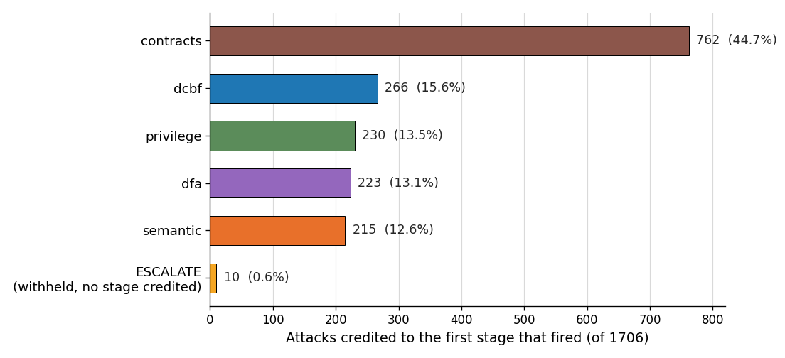

# Empirical Evaluation and Benchmark Results

This page details the empirical evaluation of GATE conducted across the **GATE-Union** benchmark suite, comprising 1,895 calls (1,706 attack traces across 15 attack families and 189 benign traces).

The benchmark evaluates the reference monitor across five sequential layers:
1. **Privilege enforcement**
2. **DFA supervision**
3. **Smart contracts**
4. **D-CBF safety barrier**
5. **Semantic firewall**

---

## 1. Multi-Stage Layer Attribution

The reference monitor enforces defense-in-depth: upstream deterministic invariants catch structural violations in microseconds, ensuring that expensive or ambiguous calls are rejected before reaching model-based semantic scoring.

### Key Findings:
- **Upstream Filtering:** 86.8% of attacks (1,481 of 1,706) are neutralized by Stages 1 to 4 before invoking the semantic embedding model: 762 at contracts, 266 at D-CBF, 230 at privilege and 223 at the DFA.
- **Sub-millisecond Short-Circuit:** The 1,481 calls stopped by a deterministic stage return with a median of 0.46 ms; the 414 calls that reach the encoders cost 68.4 ms of model time on the allowed path.
- **Semantic Stage:** 225 attacks reach the firewall, which hard-blocks 205 and withholds 10 under deny-by-default; no attack executes.

---

## 2. Layer Ablation and Defense-in-Depth

To measure the necessity of each stage, we performed systematic ablation where individual stages or combinations were removed.

### Ablation Outcomes:
- **Deterministic Layers are Foundational:** Disabling privilege and contract checking causes the attack pass-through rate to jump from 0.0% to over 64%, because intent-matching alone cannot verify database schemas, argument sanitization, or permission boundaries.
- **Cascading Defeats:** When all non-semantic stages are bypassed, the semantic firewall alone admits subtle prompt injections and off-policy parameter manipulation.
- **Fail-Closed Guarantees:** No single layer is sufficient on its own. Total defense requires pairing deterministic invariants with stateful barrier constraints and intent scoring.

---

## 3. Fused Harm and Human-in-the-Loop Escalation

Calls falling into the semantic uncertainty band ($0.60 \le \text{SSS} \le 0.75$) are subjected to a fused cross-encoder Natural Language Inference (NLI) harm barrier before being routed to a human approver.

### Evaluation Metrics:
- **Measured Review Burden:** On the 1,895-call adversarial stress benchmark, **1.0%** of requests (19 of 1,895) require human review. On the benign controls the escalation rate is **4.8%** (9 of 189) and no benign call is hard-blocked.
- **Automated Rejection in the Ambiguity Band:** The fused harm gate ($h(a) \ge 0.80$) catches severe risks directly in the uncertainty band without imposing human review overhead.
- **Fail-Closed SLA:** If an escalated request is rejected or the human queue SLA expires, the execution fails closed.

---

## 4. Adversarial Intent-Anchor Perturbation

We stress-tested the semantic stage against self-anchoring attacks (where an attacker crafts the user prompt to align with their malicious tool payload).

### Critical Findings:
- **Measured Semantic Defeat:** Anchoring the intent on the attack text releases 162 of the 225 attacks whose published decision is made at the semantic stage (**72.0%**), with the deterministic stages left in place, because $d_{\text{intent}} \approx 0$ when the attacker controls the prompt. A neutral anchor releases 2 of 225.
- **The Remedy is Provenance:** Sourcing the anchor from a channel the model cannot write restores the control outcome (215 blocked, 10 withheld, none released); the deterministic stages remain necessary because they decide every call that never reaches the firewall.
- **Provable Need for Non-Semantic Defenses:** This empirical result proves that prompt filtering and semantic intent matching alone can never serve as a standalone security boundary; non-semantic invariants are strictly required.

---

## Summary of Empirical Benchmarks

| Metric | GATE Full Pipeline | Semantic-Only Baseline | No Defense |
|---|---|---|---|
| **Attack Neutralization Rate** | **100.0%** (1,696 blocked, 10 withheld / 1,706) | 77.3% blocked, 22.7% withheld / 225 | 0.0% (all execute) |
| **Benign Auto-Allow Rate** | **95.2%** (180 / 189) | 95.2% (180 / 189) | 100.0% |
| **Human Review Burden (Stress)** | **1.0%** (19 / 1,895) | 4.8% of benign, 23% of semantic-stage attacks | 0.0% |
| **Median Decision Latency** | **0.46 ms** (deterministic short-circuit) | 180 ms end to end (model path) | 0.0 ms |
