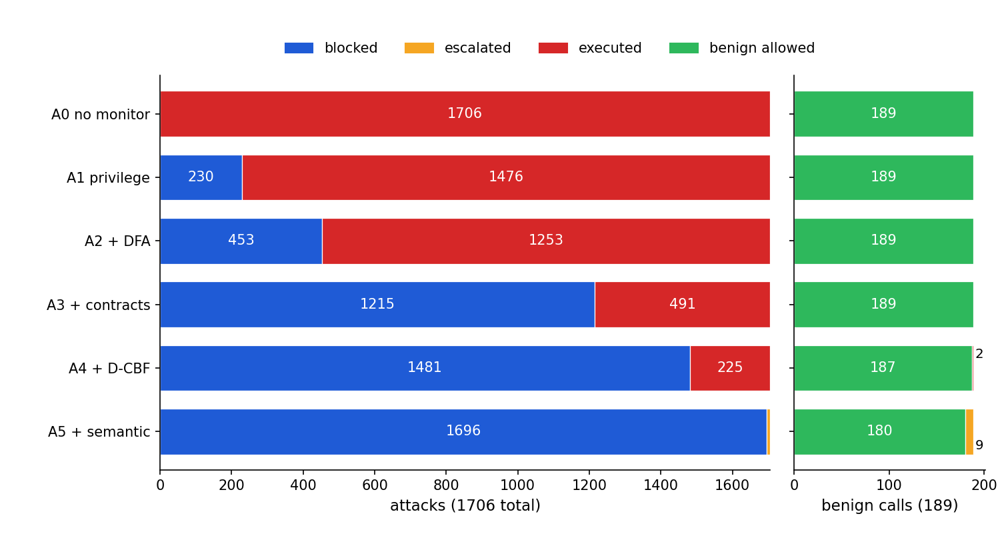
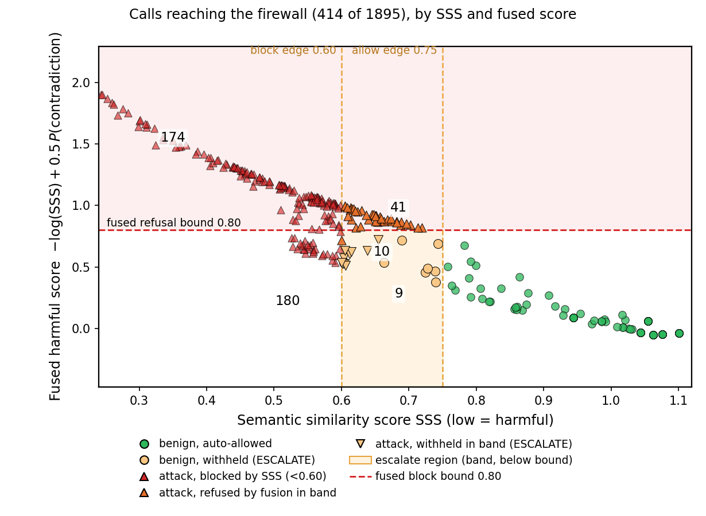
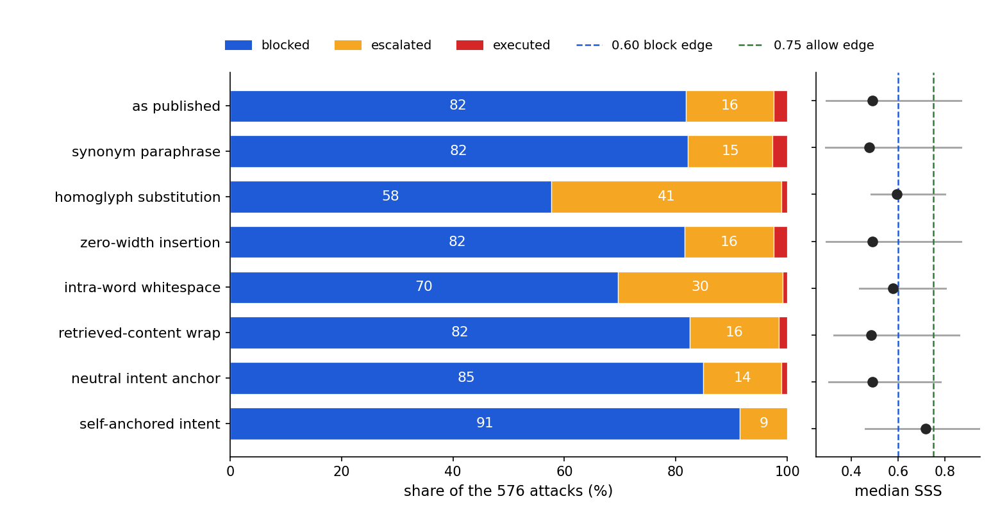

# Empirical Evaluation and Benchmark Results

This page reports the empirical evaluation of the GATE reference monitor on the **1,957-case corpus** (1,653 attack cases across the A–K taxonomy plus the external X family, and 304 benign cases, of which 9 are approval-gated controls). The pipeline decides 1,948 cases; the 9 approval-gated benign rows are withheld for a human and are excluded from the confusion counts.

The monitor enforces six sequential layers, with human-in-the-loop (HITL) as the final decision on a withheld call rather than a seventh layer. In reference-monitor naming the order is capability (privilege), workflow (DFA), semantic, IFC, contracts, D-CBF, then HITL. Tenant isolation runs before the pipeline and postcondition verification after execution.

All numbers below are measured on this corpus (`gate-zero-trust/target/audit_replay/evaluation.json`); the figures are generated from the same artefact so they cannot drift from the text.

> **Containment is partial on this corpus.** The full pipeline contains 1,339 of 1,653 attacks (81.0%); **314 attacks execute end to end and are reported as escapes, not averaged away.** This is the central negative result. The corpus deliberately includes hard external cases (InjecAgent, SafeClawBench) that a research monitor does not fully contain.

---

## 1. Multi-Stage Layer Attribution

Of the 1,339 contained attacks, the enforcing layer is distributed as follows. The deterministic and flow-control stages together decide a majority of calls before, or instead of, the model-based semantic stage.

| Enforcing layer | Contained attacks | Share |
|---|---|---|
| Semantic | 559 | 41.7% |
| Contracts | 256 | 19.1% |
| Capability (privilege) | 240 | 17.9% |
| IFC | 185 | 13.8% |
| Workflow (DFA) | 57 | 4.3% |
| HITL withheld | 17 | 1.3% |
| D-CBF | 15 | 1.1% |
| Isolation | 10 | 0.7% |

### Key findings

- **Defense-in-depth is real but not total.** No single layer decides everything; the semantic stage is the largest single contributor (41.7%), with contracts, capability and IFC together deciding 50.8%.
- **Sub-millisecond structural checks.** The deterministic stages cost well under a millisecond each on average (capability 0.20 ms, workflow 0.09 ms, IFC 0.21 ms, contracts 0.07 ms, D-CBF 0.02 ms), while the semantic stage averages 63.9 ms. The full pipeline median is 123.8 ms per case.
- **Attribution is a lower bound on cooperation.** The recorded enforcing layer matches the first-blocking layer on 616 of 1,339 contained attacks (46.0%); the rest are caught by a later stage after an earlier one also fired.

---

## 2. Layer Ablation and Defense-in-Depth

Each rung adds one or more stages to the previous configuration. Recall rises monotonically and precision stays above 0.993, so every added stage contributes non-redundantly.

| Configuration | Contained (TP) | Recall | Precision |
|---|---|---|---|
| No monitor (allow all) | 4 | 0.0024 | 1.000 |
| + capability | 257 | 0.1555 | 0.996 |
| + contracts | 1,147 | 0.6939 | 0.993 |
| + IFC (static + IFC) | 1,205 | 0.7290 | 0.993 |
| Full (+ workflow, D-CBF, semantic, HITL) | 1,339 | 0.8100 | 0.994 |

Leave-one-out (ΔRecall when a single stage is removed from the full pipeline): contracts −0.138, capability −0.048, semantic −0.047, IFC −0.019, workflow/HITL −0.010, D-CBF −0.007.

### Ablation outcomes

- **Deterministic layers are foundational.** Removing contracts alone drops recall by 13.8 points; capability and contracts together account for the jump from 0.16 to 0.69.
- **No single layer is sufficient.** Even the full pipeline leaves 314 escapes; the semantic stage alone admits subtle injections that the structural stages catch, and vice versa.
- **Fail-closed guarantees.** A scoring or embedding error produces a BLOCK, and an unapproved escalation is refused.

---

## 3. Fused Harm and Human-in-the-Loop Escalation

Calls whose Semantic Safety Score falls in the uncertainty band (`0.60 <= SSS <= 0.75`) are checked by a fused cross-encoder NLI harm score, `-log(SSS) + 0.5 * P(contradiction)`, with a refusal bound at 0.80. The fusion is one-sided: it can turn a band escalation into a block, never an escalation into an allow.

### Evaluation metrics

- **Measured review burden.** 26 of 1,957 cases (1.33%, CI [0.9, 1.9]) are routed to a human: 9 benign approval-gated controls and 17 attacks.
- **Benign auto-allow.** 287 of 304 benign cases (94.4%) are allowed without review; 8 (2.6%) are hard-blocked. A with-reviewer benign rate of 97.4% is an assumed upper bound, not a measurement.
- **Automated rejection in the band.** The fused gate refuses severe risks directly in the uncertainty band without adding human review.
- **Fail-closed SLA.** A rejected or expired approval refuses execution.

---

## 4. Adversarial Intent-Anchor Perturbation

The semantic stage was stress-tested on the 576 attacks the reference monitor decides at the semantic stage or withholds in HITL (559 semantic + 17 HITL), across eight perturbations (4,608 evaluations), scored by the shipped firewall in isolation.

### Critical findings

- **Self-anchoring raises the score but does not release calls.** Anchoring the trajectory on the attack text raises the SSS on every one of the 576 calls (mean +0.236), and 166 cross the 0.75 allow line. The degenerate-anchor guard nevertheless contains all 576 (100%, zero released): an anchor that is a near-copy of the action is treated as untrusted and escalated, never allowed.
- **The remedy is provenance.** Minting the anchor where the user's goal enters the system (an HMAC over the goal text with a key the monitor holds) and refusing an unverified anchor removes the self-anchoring failure mode.
- **Non-semantic defenses remain necessary.** The structural stages decide every call that never reaches the firewall; semantic intent matching alone is not a security boundary.

---

## Summary of Empirical Benchmarks

| Metric | Full pipeline | No defense |
|---|---|---|
| Attack containment | **81.0%** (1,339 / 1,653; CI [79.0, 82.8]) | 0.2% |
| Hard-blocked attacks | 80.0% (1,322 / 1,653) | 0.0% |
| Attack escapes (executed) | **314** (reported, not averaged away) | 1,649 |
| Benign auto-allow | 94.4% (287 / 304) | 100.0% |
| Human review burden | 1.33% (26 / 1,957) | 0.0% |
| Median full-pipeline latency | 123.8 ms | 0.0 ms |

Held-out test split: 648 / 788 attacks contained (82.2%). External-only (X family): 699 / 937 (74.6%), confirming that the external cases are the harder tail and that containment is partial.

These results are a research measurement on a fixed corpus, not a production guarantee. Read [Security model](security-model.md) for the threat model and known gaps before deploying GATE in a live path.