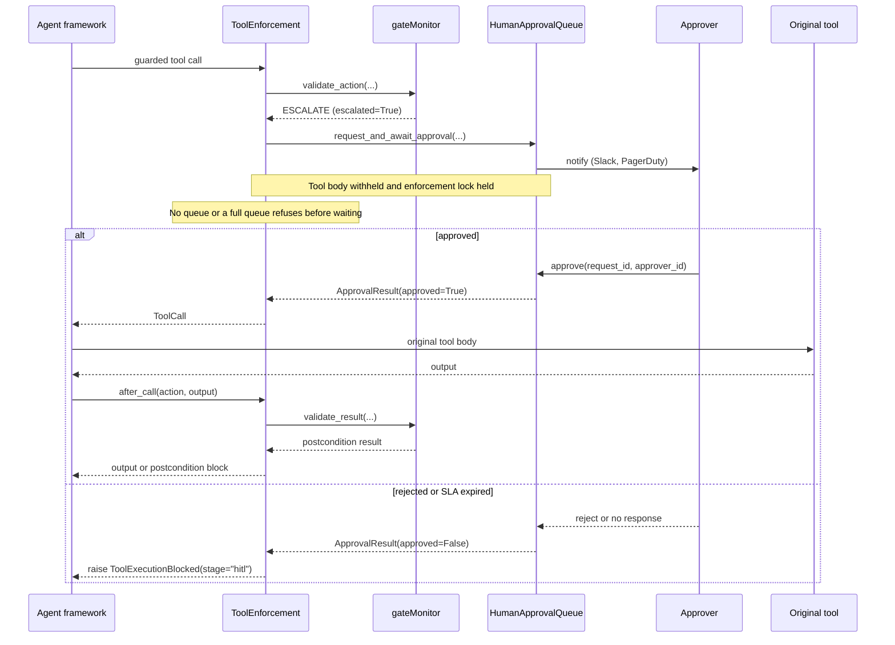

# Human-in-the-loop

A semantic `ESCALATE` is a third outcome: the action is neither clearly safe nor clearly harmful. GATE withholds it and asks a human. Until a human approves, the tool body does not run. If no approval queue is configured, the escalation becomes a refusal.

Only the semantic stage escalates. Privilege, DFA, contracts, and D-CBF return binary decisions.

## Configure a queue

```python
from gate.security.hitl_queue import (
    HumanApprovalQueue,
    PagerDutyNotificationChannel,
    SlackNotificationChannel,
)

queue = HumanApprovalQueue(
    notification_channels=[
        SlackNotificationChannel(
            webhook_url="https://hooks.slack.com/services/...",
            channel="#agent-approvals",
        )
    ],
    default_sla_seconds=300,
    max_pending_requests=100,
)

secure = wrap_agent(graph, "langgraph", config, approval_queue=queue)
```

All four adapters accept `approval_queue=`.

## What happens on an escalation

1. The monitor returns `ValidationResult(is_allowed=False, escalated=True, requires_approval=True, semantic_score=...)`.
2. `ToolEnforcement.before_call` calls `queue.request_and_await_approval(action, agent_id, risk_level="high", tenant_id=config.tenant_id)`.
3. The queue creates an `ApprovalRequest` with a UUID, sends it to every configured notification channel, and waits for a resolution or the SLA.
4. The queue returns an `ApprovalResult`.
5. If approved, the guard records the approval in `action.metadata["hitl_approval"]`, returns the `ToolCall`, and the framework dispatches the tool. The postcondition check still runs after execution.
6. If the result is not approved, the guard raises `ToolExecutionBlocked` with stage `hitl`.

The tool is withheld while the queue waits. For a synchronous framework invocation, the call to `secure.invoke` blocks until the approval resolves or the SLA expires.



## Resolving a request

The approval queue API is async:

```python
await queue.approve(request_id, approver_id="alice", justification="looks fine")
await queue.reject(request_id, approver_id="alice", reason="wrong customer")
```

From a thread outside the monitor loop, use the enforcement bridge:

```python
secure.enforcement.approve(request_id, "alice", "looks fine")
secure.enforcement.reject(request_id, "alice", "wrong customer")
```

Those methods submit the queue coroutine to the loop that is currently awaiting the approval and wait up to ten seconds. They raise `AdapterError` when no approval is pending, and they refuse to block the monitor loop itself.

To find the request identifier, inspect `queue.get_pending_requests()`:

```python
for request in queue.get_pending_requests():
    print(request.request_id, request.agent_id, request.action.tool_name, request.risk_level)
```

## Denial conditions

| Condition | Result |
|---|---|
| No approval queue configured | Refused before any wait |
| Queue has reached `max_pending_requests` | Denied immediately with `justification="Approval queue full"` |
| SLA elapses | Denied with `justification="SLA timeout (<n>s)"` and status `EXPIRED` |
| Human rejects | Denied with the approver's reason |
| Human approves | Call dispatched |

A denial raises `ToolExecutionBlocked` with `stage="hitl"` and the original semantic result attached. The semantic score is available on `exc.result.semantic_score`.

## Notification channels

Two channels are provided:

| Channel | Transport | Constructor |
|---|---|---|
| Slack | Incoming webhook JSON POST | `SlackNotificationChannel(webhook_url, channel)` |
| PagerDuty | Events API v2 | `PagerDutyNotificationChannel(integration_key)` |

Both send a blocking HTTP request in a thread pool. Notification failures are logged and ignored; they do not approve, deny, or fail the request. A silent webhook therefore leaves the call waiting until its SLA. Add an out-of-band monitor for pending requests if notifications are unreliable.

A custom channel subclasses `NotificationChannel` and implements `async def send(request) -> bool`.

## Locking and concurrency

`before_call` holds the enforcement's re-entrant lock while it awaits the human. While one call is escalated, other guarded tool calls in the same run block before validation. They do not run, but they also do not fail fast.

This matters if the approval workflow itself needs to call a tool through the same wrapped agent. It will deadlock until the SLA expires. Resolve approvals from a separate thread or process that does not call back into the same enforcement.

Each approval request is independent, but the enforcement serializes the calls that create them.

## What is recorded

`ApprovalRequest` stores the agent, tenant, action, risk level, creation time, resolver, justification, and status. The queue keeps:

- `get_pending_requests()`: unresolved requests,
- `get_audit_log()`: resolved and expired requests, in memory.

The queue's audit log is separate from `EncryptedAuditLogger`. The monitor does not write approval decisions to the encrypted logger, and the adapters do not attach a logger. If you need durable approval records, persist the queue's audit log yourself or instrument the approval path in host code.

## Trust model

The queue authenticates nothing. `approver_id` is a string supplied by the caller, and the bridge methods are callable by any code with a reference to the secure agent. Put the approval surface behind your own authentication and authorization boundary. The queue is a coordination primitive, not an identity system.

SLA values are not a security control against a malicious approver; they bound how long a benign request can block a run.

## Related pages

- [Semantic firewall](stages/semantic-firewall.md) for the only source of escalations.
- [Audit](audit.md) for durable event logging.
- [Architecture](architecture.md) for the call lifecycle.
