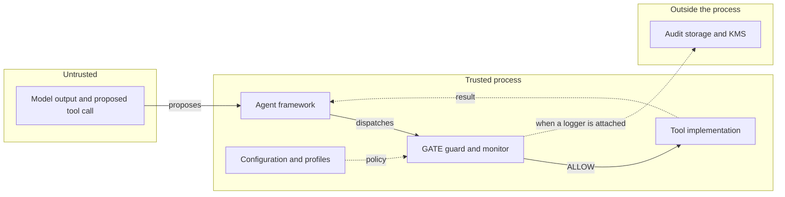

# Security model

GATE is a runtime guard at the tool-dispatch boundary. This page states what it protects, what it assumes, and where it can be bypassed. Read it before treating a GATE decision as an authorization guarantee.

## Trust boundaries

| Component | Trust |
|---|---|
| The model and its outputs | Untrusted. The agent may propose any action. |
| The agent framework | Trusted code in the same process. GATE relies on the framework dispatching through the guarded methods. |
| Tool implementations | Trusted code in the same process. GATE does not sandbox them. |
| GATE configuration and profiles | Trusted. An attacker who can edit `allowed_tools` has already won. |
| Human approvers | Trusted, but not authenticated by GATE. |
| Harm prototypes and safe centroids | Trusted data. Poisoned prototypes change decisions. |
| Audit storage and KMS | Trusted, and outside the process. |

Everything inside the process is trusted code. GATE mediates the edge that runs from the framework to the tool; it cannot defend the process, the tool bodies, or the configuration from an attacker who already executes inside it.

GATE assumes the process itself is not compromised. It does not protect against an attacker who can import Python, patch the monitor, modify the tool object before wrapping, or read the configuration. It is a policy-enforcement layer, not a sandbox or a TCB.

## Guarantees

For a **guarded** tool call through a framework dispatch path:

1. **No body before a decision.** The original tool body runs only after the monitor returns ALLOW, or after a human approves an escalation. A BLOCK, a refusal before the monitor, or a failed approval prevents execution.
2. **First denial wins.** Stages run in a fixed order and stop at the first denial. A later stage cannot override an earlier refusal.
3. **Postcondition failures withhold output.** A failed postcondition raises `ToolExecutionBlocked(post_execution=True)` and its output never reaches the agent.
4. **Semantic errors fail closed.** A scoring or embedding error produces a BLOCK score.
5. **Pre-monitor guard failures prevent dispatch.** A completed-run refusal, an illegal DFA hop, or a monitor timeout raises before the original tool body is called.
6. **Approval is required for escalation.** An escalated call is not dispatched silently. Without a queue it is refused; with a queue it waits for an explicit approval.

The guarantees are conditional on the call actually reaching the guard. The next section lists the ways it may not.

## Known gaps and bypasses

### Tool discovery is incomplete by construction

GATE guards tool objects it can see. A tool the adapter never receives is not mediated.

| Situation | Result |
|---|---|
| LangChain compiled graph with no discoverable `ToolNode` | Adapter returns an empty tool list and wraps with no guards |
| Tool inside a nested LangGraph subgraph not exposed at the top level | Not discovered; pass `tools=` |
| Tool added to an agent, crew, or graph after wrapping | Not guarded |
| CrewAI tool created or managed outside `agents[*].tools` and `tasks[*].tools` | Not guarded |
| A second reference to the same underlying function | Only the guarded object is mediated |

Always assert that the tools you expect carry `_gate_enforcement`. Passing `tools=` explicitly is the reliable option.

### Dispatch can bypass the guard

The guard shadows `_run`/`_arun` or `on_invoke_tool` on the object. Code that calls the underlying function directly bypasses it:

- Calling `StructuredTool.func(...)` instead of `tool.run(...)` or `tool.invoke(...)`.
- Holding a reference to the original bound method captured before wrapping.
- Calling a different tool object that wraps the same callable.
- A framework path that invokes the tool implementation outside the intercepted method.

GATE cannot detect these. Keep the tool object as the only handle, and do not hand out raw callables.

### The checks are heuristics

| Stage | Limitation |
|---|---|
| Privilege | Data-scope checking applies only to string arguments containing a dot and no whitespace or `@`. Undotted identifiers and non-string resources are not checked. The cost check uses a per-call estimate the adapters never set, and is not cumulative. |
| DFA | Phases are inferred from tool calls. The stage enforces step and loop budgets, not a task plan or tool ordering. |
| Contracts | Exact tool-name matching. Built-in SQL rules are keyword and regex checks; the row limit is recorded but not applied to the dispatched query. Code-execution rules are substring checks that are easy to evade. |
| Semantic | Embedding similarity with prototypes that are not shipped. It is not adversarially robust and can be shaped by the same arguments an attacker controls. |
| D-CBF | Simulated next state omits tool history and embeddings. Default privacy and safety barriers can be overly restrictive rather than too permissive; the scope barrier is inert in the adapter path. |

### Postconditions are not transactions

A postcondition runs after the side effect. It can hide the result but cannot roll back a sent email, a committed write, or an issued refund. Design tools to be idempotent, or pair them with compensating actions.

### Human approval is a coordination primitive

`approver_id` is an unauthenticated string. The approval bridge is callable by any code holding the secure agent. Put your own authentication and authorization in front of the approval surface. A pending approval also holds the enforcement lock, so unrelated tool calls in the same run wait.

### Audit is opt-in and local encryption is weak

The adapters do not attach an audit logger. `gateConfig.audit_log_path` is unused. The logger's local KMS backend XORs with an in-memory key that is lost at process exit. `metadata` is not masked. See [Audit](audit.md).

### Timeouts do not kill work

On Windows and in worker threads, Python cannot interrupt the running framework call. The wrapper stops waiting and denies later tool calls, but the original work may continue. A timeout is not a cancellation guarantee.

### Prompt injection is not solved

GATE validates actions, not intentions. If an injected instruction causes the agent to call an allowed tool with arguments that satisfy the contracts, the call is allowed. The defence against that is a narrow tool surface, strict contracts, least-privilege data scopes, and human review for high-impact actions.

### Multi-tenancy is not enforced by the monitor

`tenant_id` labels HITL requests and audit events. It does not partition enforcement state, tool access, or memory. One wrapped agent operates in one tenant. Use separate processes or separate wrapped agents for separate tenants, and enforce isolation at the storage layer.

## Threat model

In scope:

- A model or prompt-injection attacker proposing harmful or out-of-policy tool calls.
- Accidental misuse of a powerful tool by a well-behaved agent.
- Excessive tool use (step, loop, or repeated outbound actions).
- Data-scope violations expressed as dotted resource names.
- Known-bad SQL, HTTP, email, and code patterns.
- Semantic drift from the user's stated request.
- Explicit human review for fuzzy cases.

Out of scope:

- A compromised Python process, interpreter, or dependency.
- Malicious tool code running with host permissions.
- Sandboxing, container escape, or network isolation.
- Cryptographic protection of the model, prompts, or in-memory state.
- Authenticating the human approver.
- Guaranteeing that every tool in a framework is discovered.
- Undoing a side effect that already occurred.

## Deployment guidance

1. Use a deny-by-default profile. Start with an empty `allowed_tools` and add exactly what the agent needs.
2. Pass `tools=` explicitly for every framework and assert `_gate_enforcement` on each expected tool.
3. Keep the guarded tool object as the only handle. Do not expose raw callables.
4. Enable the deterministic stages first: privilege, DFA, contracts. Measure the block rate on normal traffic before adding semantic or D-CBF.
5. Populate semantic prototypes from your own action distribution, not from generic examples alone.
6. Replace the built-in email, HTTP, and code contracts with application-specific ones. The built-ins are examples.
7. Route high-impact actions through HITL with an authenticated approval surface, and shorten the SLA.
8. Persist approval decisions and audit events to a durable, access-controlled store. Use a real KMS.
9. Run tools that touch untrusted input in a separate process or container. GATE is not a sandbox.
10. Pin framework versions and run the integration suite after every upgrade.
11. Test the negative cases: a direct `tool.func(...)` call, a newly added tool, a nested graph, a rejected approval, an expired SLA. Confirm what your deployment actually mediates.

## Reporting

GATE is research software at version 1.1.0. If you find a bypass, open an issue with a minimal reproduction and state whether the tool reached the guard. Do not include secrets or live credentials in a report.

## Related pages

- [Architecture](architecture.md)
- [Adapters](adapters/README.md)
- [Audit](audit.md)
- [Human-in-the-loop](human-in-the-loop.md)
