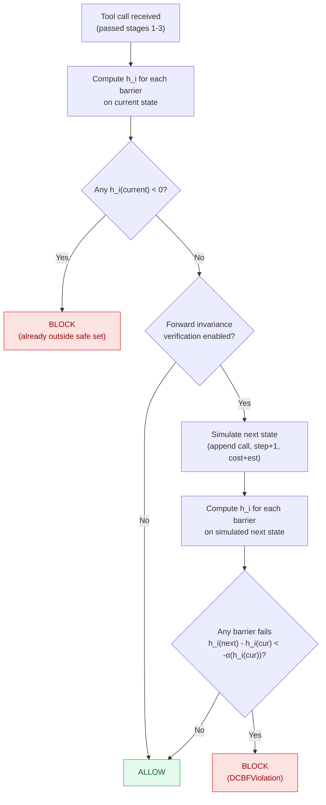

# D-CBF monitor

The D-CBF (discrete control barrier function) stage asks whether the next action keeps the agent inside a safe set defined by five barrier functions. It runs after privilege, DFA and contracts and immediately before the semantic firewall, so a barrier violation is blocked outright before an ambiguous call can be escalated past it.

## The safe set

Each barrier `i` defines a scalar value `h_i(state)`. The safe set is the intersection:

```text
C = { state : h_i(state) >= 0 for every barrier i }
```

The monitor admits a transition only when:

1. the current state is inside `C` (every `h_i >= 0`), and
2. every barrier satisfies the discrete forward-invariance condition

```text
h_i(next) - h_i(current) >= -alpha(h_i(current))
```

where `alpha(h) = kappa * h^power`. The default is `kappa = 1.0` and `power = 1`, so the condition reduces to `h_i(next) >= 0`: the call is refused if it would take any barrier out of the safe set. `kappa < 1` demands a proportional margin instead of mere non-negativity. A single breached barrier denies the action regardless of the other barriers.

`enable_forward_invariance_verification=False` skips step 2 and checks only that the current state is inside the safe set. `gateConfig.enable_forward_invariance_verification` defaults to `True`.

## Evaluation flow




## Default barriers

The monitor is constructed with these five barriers unless you build your own:

| Barrier | Weight | Margin | Raw value | Effective `h` |
|---|---|---|---|---|
| `safety` | 1.0 | 0.1 | `1.0 - risk`, where risk counts dangerous tool combinations in the last five calls | `raw - 0.1` |
| `privacy` | 1.5 | 0.0 | `privacy_budget - 0.2 * count(send_email, http_request)` over the whole history, with `privacy_budget` defaulting to `0.5` | `raw` |
| `resource` | 1.0 | 0.0 | `10.0 - cost_usd` | `raw` |
| `scope` | 1.2 | 0.0 | `0.8 - L2(action_embedding, context_embedding)`, or `0.8` if either embedding is unset | `raw` |
| `stability` | 1.0 | 0.0 | `50 - step_count` | `raw` |

Dangerous combinations for the safety barrier:

```text
{sql_query, http_request}
{file_read, send_email}
{database_query, webhook_post}
```

A barrier that raises during evaluation returns `-1.0`, which is treated as unsafe.

The barrier values are **not** configurable through `gateConfig` in the adapter path. The monitor constructs `EnhancedDCBFMonitor(enable_verification=...)` and accepts its defaults of `safety_margin=0.1`, `privacy_budget=0.5`, `resource_limit=10.0`, `max_drift=0.8`, `step_budget=50`, and `per_call_cost_usd=0.01`. `resource_budget.max_cost_usd` and `resource_budget.max_steps` do not feed these bars.

## What the defaults do in practice

Two consequences are easy to miss:

**The privacy barrier permits two outbound calls and refuses the third.** Its value is `0.5 - 0.2 * count`, so a history with two `send_email` or `http_request` calls sits at `0.1` and the forward check refuses the next one, which would take it to `-0.1`. Because the history never loses entries, the refusal is permanent for that run; a denied call does not add history, so the run cannot recover. If your agent sends mail or makes many outbound requests, replace this barrier or use a custom monitor before enabling D-CBF.

**The stability barrier matches the DFA step budget rather than anticipating it.** With `alpha(h) = h` the forward condition asks only that the next step stay inside the budget, so the last admitted call is the one that brings `step_count` to `step_budget`. When both budgets are 50 the two stages admit the same call; the D-CBF budget matters only when it is set lower than `max_steps`, as the benchmark's per-case envelopes do (6, 12 and 20 steps).

The resource barrier charges the declared `estimated_cost` metadata, or `per_call_cost_usd` when the call declares none, in the simulated next state. The adapter path never increments `state.resource_usage.cost_usd` after a call, so the real spend stays at zero and the forward check is conservative: it can refuse a call the runtime would not have charged for, never the reverse.

The scope barrier is inert unless something populates `state.context_embedding` and `state.action_embedding`. The adapters do not.

The safety barrier can also be terminal: once a run has both tools of a dangerous pair in its last five calls, the barrier is negative and no further call can succeed to push the pair out of the window.

## Next-state simulation

For the forward-invariance test, `_simulate_next_state` copies the current state and changes exactly the components the barriers read:

- appends the proposed `ToolCall` to a copy of `tool_history`
- `cost_usd` plus the call's `estimated_cost` metadata, or `per_call_cost_usd` (default `0.01`)
- `step_count + 1`
- a copy of `loop_count`
- phase `ACTING`

`context_embedding` and `action_embedding` are carried unchanged, because the outbound content is unknown before execution. The safety and privacy barriers therefore see the proposed call in the history, which is what makes the check a real one-step lookahead rather than a fixed increment.

## Composite value

`evaluate_state(state)` returns the weighted **average** of the barrier values, despite its docstring saying "weighted minimum". That composite is used by `check_state_invariants`; it does not drive `check_transition`, which evaluates each barrier separately. A positive composite therefore does not imply a safe state, and `verify_forward_invariance` now tests each barrier separately too. Use `get_barrier_values(state)` when you need the per-barrier picture.

`check_state_invariants` calls `evaluate_state` and tests `>= 0`. Because this is an average, a negative privacy or safety barrier can be masked by healthy resource and stability barriers.

## Custom barriers

```python
from gate.core.monitor import gateMonitor
from gate.security.dcbf_monitor import EnhancedDCBFMonitor

dcbf = EnhancedDCBFMonitor(enable_verification=True, step_budget=25)
dcbf.remove_barrier("privacy")
dcbf.add_barrier(
    "privacy",
    lambda state: 1.0 - 0.05 * sum(
        1 for call in state.tool_history if call.tool_name in {"send_email", "http_request"}
    ),
    weight=1.5,
    margin=0.0,
)

monitor = gateMonitor(config, dcbf_monitor=dcbf)
```

`add_barrier(name, func, weight=1.0, margin=0.0)` replaces a barrier with the same name. `remove_barrier(name)` deletes it. The callable receives the `AgentState` and returns the raw value; the monitor subtracts the margin.

The four adapters construct their own monitor and do not accept a D-CBF instance. Use the monitor plus `ToolEnforcement` directly or write a custom adapter to use custom barriers.

## Offline verification

`verify_forward_invariance(test_states, test_actions)` reports how often the condition fails over a dataset:

```python
report = dcbf.verify_forward_invariance(states, actions)
# {"total_checks": ..., "violations": ..., "violation_rate": ..., "forward_invariant": bool}
```

It skips states that are already outside the safe set (any barrier negative), then simulates the next state and tests the same per-barrier condition `check_transition` applies. A transition is counted as a violation if any barrier fails. This is a diagnostic for barrier design, not a runtime check.

## Neural CBF

`NeuralCBFConfig` can replace the hand-designed monitor with `NeuralCBF`:

```python
from gate import NeuralCBFConfig

config.neural_cbf_config = NeuralCBFConfig(
    enabled=True,
    model_path="models/ncbf.pt",
    device="cpu",
)
```

With `enabled=True` and the `dcbf` stage enabled, the monitor builds `NeuralCBF` instead of `EnhancedDCBFMonitor`. The module is experimental and is not exercised by the integration tests in the same way as the hand-designed barriers. Read [Standalone utilities](../standalone-utilities.md) before relying on it.

## Failure modes

- A barrier exception becomes `-1.0` and denies the transition.
- A D-CBF denial raises `DCBFViolation`; the monitor records `checks_failed=["dcbf"]` and the guard raises `ToolExecutionBlocked`.
- An unexpected exception outside a barrier's own try block propagates out of `validate_action` and prevents dispatch without producing a `ValidationResult`.
- D-CBF runs before the semantic stage, so barrier violations are blocked outright before escalation can be considered.
- A framework that dispatches several tool calls as one concurrent batch checks each call against the same pre-batch history, because history is recorded when a call returns. A batch of outbound calls can therefore pass the per-call successor test together even though the batch as a whole would leave the safe set. Sequential dispatch, the common one-call-per-turn loop, accumulates normally. With LangGraph's `ToolNode`, a batch of tool calls in a single `AIMessage` is dispatched concurrently, so use one call per message when the stateful barriers matter.

## Related pages

- [Semantic firewall](semantic-firewall.md) for the subsequent stage.
- [Architecture](../architecture.md) for the full validation order.
- [Standalone utilities](../standalone-utilities.md) for Neural CBF and the circuit breaker.
