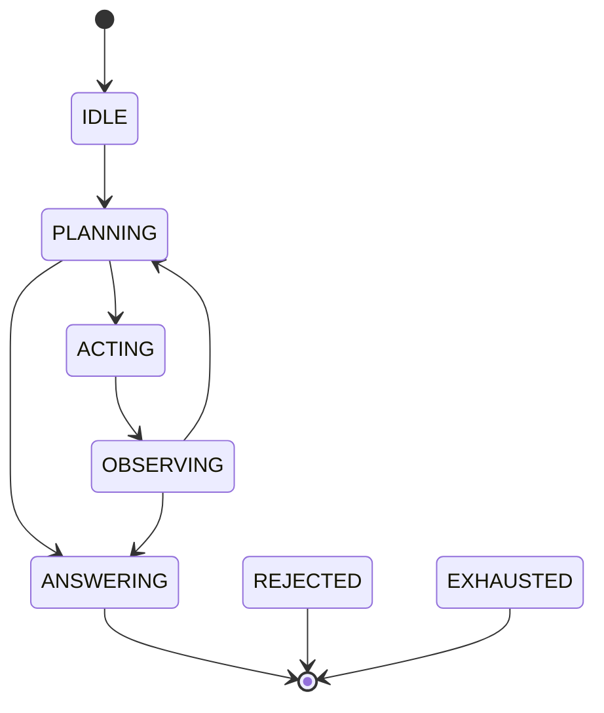

# DFA supervision

The DFA stage constrains where in an agent's execution a tool call is legal and how many steps or nested calls a run may take. It is a deterministic state machine, not a model of the task plan.

## Phases and transitions



`ANSWERING`, `REJECTED`, and `EXHAUSTED` are terminal. The default transition set is exactly the edges drawn above. `REJECTED` and `EXHAUSTED` are defined as terminal states but nothing in the monitor transitions into them; a run that exceeds its budget is denied with a DFA violation rather than moved to `EXHAUSTED`.

## How the guard drives the machine

The framework does not tell GATE when it is planning or observing, so the guard infers phase transitions around each tool call:

1. At the start of a run, the phase is `IDLE`.
2. On the first tool call, the guard proposes `IDLE -> PLANNING`, then `PLANNING -> ACTING`, and sets the phase to `ACTING`.
3. After a successful call, `after_call` sets the phase to `OBSERVING`.
4. The next tool call proposes `OBSERVING -> PLANNING -> ACTING` again.
5. `finish_run()` sets `ANSWERING` when the framework call returns, including when it raises.

Each proposal is checked by `DefaultDFASupervisor.propose_transition`, which enforces the step budget, terminal states, loop limits, and the transition table. If a hop is illegal, the guard raises `ToolExecutionBlocked` with no `ValidationResult` and stage `dfa`, before the monitor runs.

When a tool calls another guarded tool from inside its own body, the outer call has not reached `after_call` yet, so the phase is still `ACTING`. The inner call is an `ACTING` self-loop. The guard checks `validate_action_phase`, increments `loop_count["ACTING"]`, and proceeds. This is the path the per-phase loop budget exists for.

## Step budget

`max_steps` comes from `config.agent_profile.resource_budget.max_steps` and defaults to 50. The state's `step_count` increments in `after_call`, so it counts successfully executed tool calls. The check refuses a call when `step_count >= max_steps`:

- With `max_steps=20`, calls 1 through 20 can execute; call 21 is denied.
- A denied call does not increment the counter.

The refusal happens on the next `propose_transition`, before the monitor's DFA check, so `ToolExecutionBlocked.result` is `None`. The exception message contains `Step budget exhausted: 20/20`.

## Loop budget

`max_loops_per_phase` comes from the same budget object and defaults to 3. On an `ACTING` self-loop, the guard calls `validate_action_phase`, which denies once `loop_count["ACTING"] >= max_loops_per_phase`. With the default of 3, a tool may invoke another guarded tool at most three times before returning to planning; the fourth nested call is refused.

Normal sequential tool calls do not count as loops because `after_call` moves the run to `OBSERVING` between calls. Parallel tool calls dispatched by a `ToolNode` are processed one after another through the same guard; the first moves the state to `OBSERVING` after its body returns, so the second is a normal `OBSERVING -> PLANNING -> ACTING` transition.

## Completed runs

`finish_run()` is called in a `finally` block by every adapter. It sets `ANSWERING` once, on the first call. A tool call attempted after that point is refused by the enforcement layer even when the DFA stage is disabled:

```text
Cannot call <tool>: agent run is already completed
```

`abort(reason)` also marks the run finished and records the reason, which is appended to that message. Timeouts call `abort` before the secure invocation re-raises.

Calling `invoke` again on the same `SecureAgent` runs `begin_run`, which replaces the state and clears the finished flag, so sequential runs on one wrapper are supported. Concurrent runs on one wrapper are not; see [Architecture](../architecture.md#concurrency).

## What the DFA stage does not do

- It does not know what the agent is planning. Every tool call is treated as an `ACTING` phase action reached through the same auto-advance path.
- It does not constrain which tool may follow which. A `read` followed by `send_email` is a legal transition if both pass their own checks.
- It does not require the agent to spend time in `PLANNING` or `OBSERVING`; those phases are traversed in the same guard call.
- It does not move the state to `EXHAUSTED` when a budget is exceeded. The call is denied and the run state remains where it was.
- It does not stop the framework from doing non-tool work. It only gates tool dispatch.

For ordering constraints that depend on which tools were used, use a custom contract or the D-CBF safety barrier. See [Smart contracts](contracts.md) and [D-CBF monitor](dcbf.md).

## Disabling the stage

Remove `"dfa"` from `enabled_checks`. The guard still tracks phases and still refuses calls after the run finishes, but it does not consult a supervisor and therefore does not enforce step or loop budgets.

## Customising transitions

The monitor constructs `DefaultDFASupervisor` from the configured budgets. To change the transition table, construct a supervisor yourself and pass it to a manually built monitor:

```python
from gate.core.monitor import gateMonitor
from gate.security.dfa_supervisor import DefaultDFASupervisor

supervisor = DefaultDFASupervisor(max_steps=10, max_loops_per_phase=2)
supervisor.remove_transition("OBSERVING", "ANSWERING")
supervisor.add_transition("OBSERVING", "OBSERVING")

monitor = gateMonitor(config, dfa_supervisor=supervisor)
```

`add_transition` and `remove_transition` mutate the supervisor's valid-transition set. `validate_action_phase` finds a shortest legal path from the current phase to `ACTING` using breadth-first search, so removing edges can make tool calls unreachable and therefore denied.

The four framework adapters build their own monitor and do not accept a supervisor argument. Custom supervisors require the monitor plus `ToolEnforcement` route or a custom adapter.

## Relevant configuration

| Field | Default | Used by |
|---|---|---|
| `enabled_checks` containing `"dfa"` | enabled | Whether the monitor runs the stage |
| `agent_profile.resource_budget.max_steps` | 50 | Supervisor step budget |
| `agent_profile.resource_budget.max_loops_per_phase` | 3 | Supervisor loop budget |

The D-CBF stability barrier has its own, separate step budget, defaulting to 50. It does not read `resource_budget.max_steps`. See [D-CBF monitor](dcbf.md).
