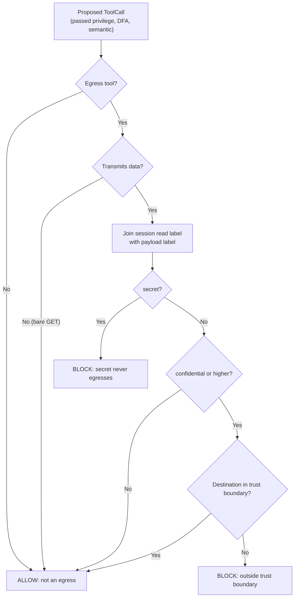

# Information-flow control (IFC)

The IFC stage is a deterministic confidentiality lattice over reads and egress calls. It runs fourth in the chain, after privilege, DFA and the semantic firewall, and before contracts and D-CBF. It tracks what the session has read and refuses to let protected data leave to a destination outside the declared trust boundary. It uses no model and returns a binary decision; it never escalates.

Unlike the semantic stage, which scores the *proposed action text*, IFC reasons about *data flow*: a read carries a confidentiality label into the session, and a later egress call is checked against the most restrictive label the session has accumulated.

## Labels

Labels are ordered from least to most restrictive:

| Label | Order |
|---|---|
| `public` | 0 |
| `internal` | 1 |
| `confidential` | 2 |
| `restricted` | 3 |
| `secret` | 4 |

Joining a set of labels returns the most restrictive one. The session starts with no labels; the effective floor when joining is `internal`.

## Reads

A read is recorded when an allowed call uses one of the read tools:

```text
sql_query, database_query, file_read, web_search, memory_read
```

`record_read` joins two signals into a single label and appends it to `state.read_labels`:

1. **Resource classification.** The `table`, `resource`, `path` and `query` arguments are scanned for confidential-resource words (customer, employee, payroll, salary, revenue, financial, directory, users, and similar). A match starts the label at `confidential`; otherwise it starts at `internal`.
2. **Payload markers.** The payload text is scanned for restricted and secret markers, which raise the label further (see below).

Reads are recorded in two places: after a call passes every pre-execution stage, and when an executed result is allowed back into the agent context (`validate_result`). A withheld or postcondition-failed result does not propagate a label.

## Egress

An egress call is checked when it uses one of:

```text
send_email, http_request, webhook_post
```

Not every call to these tools transmits data. `send_email` and `webhook_post` always transmit. `http_request` transmits only if it carries a non-empty string `body` or uses a write method (`POST`, `PUT`, `PATCH`, `DELETE`, `UPLOAD`); a bare `GET` with no body is not an egress.

For a transmitting call, IFC joins the session's accumulated read label with the label of the call's own payload, then applies two rules:

| Condition | Decision |
|---|---|
| Joined label is `secret` | BLOCK, regardless of destination |
| Joined label is `confidential` or higher and the destination is outside the trust boundary | BLOCK |
| Otherwise | ALLOW |

Secret material never crosses the boundary, even to a trusted destination. Confidential-or-higher content may leave only to a destination inside the boundary.

## Payload markers

The payload is assembled from the arguments `body`, `subject`, `attachment`, `query`, `command`, `content`, `value` and `dataset` (dict values are serialised as sorted JSON). It is scanned with regular expressions:

| Marker | Examples | Raises label to |
|---|---|---|
| Secret | AWS access keys (`AKIA…`/`ASIA…`), `-----BEGIN … PRIVATE KEY-----`, `bearer <token>`, `api_key/secret/password/token = …`, `.aws/credentials` | `secret` |
| Restricted | SSN patterns (`123-45-6789`), `SSN`, `DOB`, `date of birth`, `passport` | `restricted` |
| Confidential | customer, contact, employee, name, email, phone, address, revenue, salary, payroll, and similar | `confidential` |

A secret match overrides everything. Otherwise restricted wins over confidential.

## Trust boundary

The boundary is the union of:

- `ifc_config.trust_boundary` (hosts, domains or email domains you declare), and
- the hosts of the agent profile's `data_scope.allowed_api_endpoints`.

Entries are lowercased and matched by host. A destination is trusted if it equals a boundary entry, is a subdomain of one, or is a parent domain of one. For `send_email` the destination is the `to` address (its domain is compared); for `http_request`/`webhook_post` it is the `url` or `endpoint` host.

An empty boundary fails closed: with no declared destinations and no allowed endpoints, confidential content may not egress at all.

```python
from gate import gateConfig
from gate.core.config import IFCConfig

config = gateConfig(
    agent_profile=profile,
    ifc_config=IFCConfig(trust_boundary={"company.com", "api.trusted-partner.com"}),
)
```

## Decision flow



A block returns `is_allowed=False` with `checks_failed=["ifc"]`, logs an `IFC_VIOLATION`, and reports the session's `read_labels` and the destination in the violation details. Because IFC runs after the semantic stage, a semantic `ESCALATE` held pending is overridden by an IFC block (deny-dominant ordering).

## Limitations

- **Labels are heuristic, not a taint tracker.** Classification is regex over argument text and resource names. It does not follow data through transformations, and it cannot see content the tool returns unless that content is echoed into a later call's arguments. A read that returns sensitive data but whose arguments look ordinary is labelled only by its resource name.
- **The session label is monotonic.** Once a confidential read is recorded, every later egress in the same session inherits at least that label, even if the egress payload is unrelated. This is conservative (it over-blocks rather than leaks) but can refuse legitimate flows; declare the destination in the boundary to permit them.
- **Marker coverage is finite.** The secret/restricted/confidential patterns are a fixed list. Sensitive data that matches none of them is treated as `internal` and may egress. Treat IFC as a coarse data-loss guard, not a complete DLP system.
- **No declassification.** There is no mechanism to downgrade a label once set, other than the destination being inside the trust boundary.

## Related pages

- [Semantic firewall](semantic-firewall.md) for the preceding scoring stage.
- [Smart contracts](contracts.md) and [D-CBF monitor](dcbf.md) for the stages that follow.
- [Configuration](../configuration.md) for `IFCConfig` and `enabled_checks`.