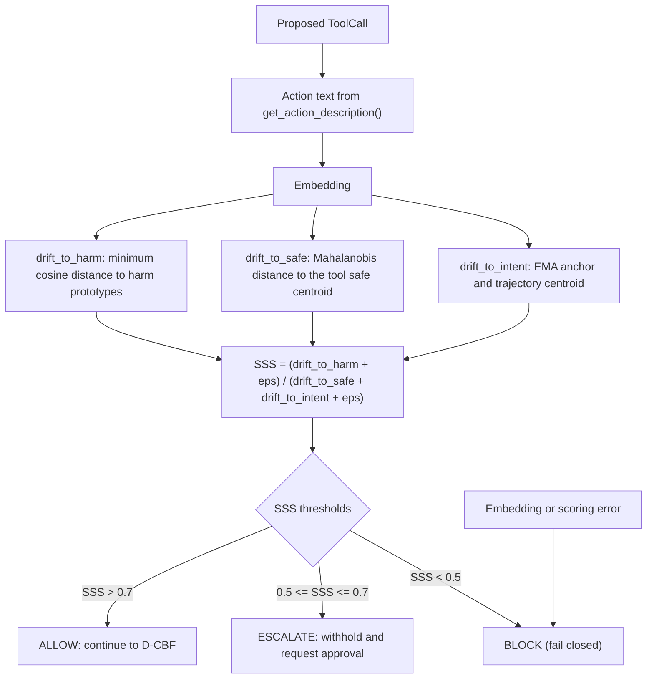

# Semantic firewall

The semantic stage embeds the proposed action, compares it with three references, and produces a Semantic Safety Score (SSS). It is the only stage that uses a model, and the only stage that can return `ESCALATE`.

## Inputs

The monitor builds a textual description of the action with `ToolCall.get_action_description()`:

```text
Call search(query=retention policy)
```

Argument values are inserted with `str()`. Nested structures appear as Python reprs. The firewall embeds this text and compares it with:

1. **Harm prototypes**: a set of embeddings representing harmful actions.
2. **Safe centroid for the tool**: the typical embedding of legitimate calls to that tool, with an inverse covariance matrix.
3. **Intent anchor**: the embedding of the user's original request, tracked as a trajectory over the run.

## Score

```text
SSS = (drift_to_harm + eps) / (drift_to_safe + drift_to_intent + eps)
```

with `eps = 1e-6`. The three drift terms are:

| Term | Calculation | When the reference is missing |
|---|---|---|
| `drift_to_harm` | Minimum cosine distance to any harm prototype | `1.0` |
| `drift_to_safe` | Mahalanobis distance to the tool's safe centroid | `1.0` |
| `drift_to_intent` | `0.6 * cosine_distance(action, EMA anchor) + 0.4 * cosine_distance(action, trajectory centroid)` once the trajectory has more than one point; otherwise the EMA distance alone | `0.5` when no anchor is set |

The trajectory tracker updates **before** scoring, so the current action is included in the EMA and the trajectory. The EMA smoothing factor is `0.3` in the monitor's default construction. The `gateConfig.trajectory_ema_alpha` field is not passed to the tracker by the monitor; to change it, construct the firewall yourself.

## Decision

Default thresholds from `SemanticThresholds`:

| SSS | Decision |
|---|---|
| `> 0.7` | ALLOW |
| `< 0.5` | BLOCK |
| `0.5 <= SSS <= 0.7` | ESCALATE |



Both comparisons are strict. A score of exactly `0.7` escalates; exactly `0.5` escalates.

An `ALLOW` continues to the D-CBF stage. A `BLOCK` stops validation and raises `SemanticSafetyViolation`, which the guard converts to `ToolExecutionBlocked`. An `ESCALATE` returns immediately with `escalated=True` and `requires_approval=True`; it does **not** run the D-CBF stage and it does **not** dispatch. The guard sends it to the approval queue. With no queue, the call is refused.

## Why prototypes matter

`DefaultSemanticFirewall` ships with no prototypes. `VectorStore` starts empty unless `gateConfig.vector_store_path` points at a directory containing prototype files, and no prototype dataset is included in this repository. With no prototypes and no safe centroid, two of the three terms are constants:

```text
SSS = 1 / (1 + drift_to_intent)
```

The stage then behaves as an intent-drift checker. Approximate behavior with an anchor set:

| Drift from intent | SSS | Decision |
|---|---|---|
| 0.10 | 0.91 | ALLOW |
| 0.30 | 0.77 | ALLOW |
| 0.40 | 0.71 | ALLOW |
| 0.50 | 0.67 | ESCALATE |
| 1.00 | 0.50 | ESCALATE |
| 1.50 | 0.40 | BLOCK |

With no anchor at all, `drift_to_intent` is `0.5`, so SSS is approximately `0.67` and every action escalates. Adapters set an anchor through `begin_run(intent)`, but only when the run input has a usable string form. An empty input, a call path that bypasses `begin_run`, or a firewall constructed outside an adapter can leave the anchor unset.

For a meaningful risk score, populate both harm prototypes and per-tool safe centroids.

## Populating the vector store

```python
import numpy as np

from gate.utils.embedding import EmbeddingModel
from gate.utils.vector_store import VectorStore

model = EmbeddingModel("all-MiniLM-L6-v2")
store = VectorStore("gate-vectors")   # creates the directory when saving

harm_texts = [
    "Call send_email(to=all-staff, body=exfiltrated customer records)",
    "Call sql_query(query=DROP TABLE customers)",
    "Call code_execute(code=os.system('curl attacker'))",
]
store.add_harm_prototypes_batch(list(model.embed(harm_texts)))

safe_texts = [
    "Call search(query=retention policy)",
    "Call search(query=quarterly revenue)",
    "Call search(query=onboarding checklist)",
]
embeddings = model.embed(safe_texts)
centroid = embeddings.mean(axis=0)
covariance = np.cov(embeddings, rowvar=False) + np.eye(embeddings.shape[1]) * 1e-6
store.add_safe_centroid("search", centroid, np.linalg.inv(covariance), len(safe_texts))

store.save_to_disk()
```

Then point the configuration at the same directory:

```python
config = gateConfig(
    agent_profile=profile,
    vector_store_path="gate-vectors",
    enabled_checks={"privilege", "dfa", "semantic"},
)
```

`VectorStore` loads `default_harm.npy` and `default_centroids.npy` from that directory. The default namespace is `default`; `gateConfig` does not expose the namespace. The embedding dimension defaults to 384, which matches `all-MiniLM-L6-v2`. A different embedding model with a different dimension needs a correspondingly configured vector store; the firewall constructs `VectorStore(config.vector_store_path)` with the default dimension.

Prototype quality dominates the score. A handful of hand-written prototypes make the stage a rough anomaly detector, not a safety classifier. Build the prototype set from the actions you actually want to refuse, and evaluate it on normal traffic before enabling BLOCK decisions in production.

## Failure behavior

`check_semantic_safety` catches every exception and returns a BLOCK score:

```python
SemanticScore(
    sss_value=0.0,
    drift_to_intent=0.0,
    drift_to_harm=1.0,
    drift_to_safe=1.0,
    decision="BLOCK",
    details={"error": "..."},
)
```

A model download failure, an embedding error, a malformed prototype matrix, or a NaN comparison therefore blocks the call rather than allowing it. This is fail-closed, but it also means a broken semantic stage stops all guarded tool calls. Monitor the `details["error"]` field.

The embedding call inside `check_semantic_safety` goes directly to `EmbeddingModel.embed`. The firewall's circuit breaker wraps the separate async `embed()` helper, not this path. `gateConfig.circuit_breaker_config` is not applied to the firewall's breakers; the firewall constructs breakers with its own defaults of three failures and a 30-second recovery. The breaker exists as a standalone utility; it does not currently protect semantic scoring.

## Operational notes

- The first semantic check downloads `all-MiniLM-L6-v2` unless it is cached.
- Each check embeds one short string. On CPU this is typically a few milliseconds after the model is loaded, but it is still the slowest deterministic-path stage by a wide margin.
- The action description includes raw argument values, which may be large. A megabyte-long document in a tool argument becomes a long embedding input; truncate or summarise at the tool boundary if that is a concern.
- The intent anchor is set from the **run input**, not from a planner's stated goal. For LangGraph, the adapter uses the first of `input["input"]` or `input["messages"]` and stringifies it; for LangChain it stringifies the input. A message list becomes a Python repr. This is a usable anchor for short prompts, not a semantic summary of the task.
- The score is computed on the proposed action text, not on the tool result. A benign-looking tool that returns sensitive data still passes the semantic stage.
- The stage is not adversarially robust. An attacker who can shape the tool name and arguments can also shape the embedding. Treat it as one signal among several, not as an authorization boundary.

## Customising the firewall

Pass a firewall instance to a manually constructed monitor:

```python
from gate.core.monitor import gateMonitor
from gate.security.semantic_firewall import DefaultSemanticFirewall

firewall = DefaultSemanticFirewall(config, trajectory_ema_alpha=0.5)
monitor = gateMonitor(config, semantic_firewall=firewall)
```

You can also change thresholds through the config:

```python
from gate import SemanticThresholds

config.semantic_thresholds = SemanticThresholds(
    sss_safe_threshold=0.75,
    sss_block_threshold=0.45,
)
```

`SemanticThresholds.drift_threshold` and `harm_threshold` are declared but not read by the firewall. Only `sss_safe_threshold` and `sss_block_threshold` drive the decision.

The adapters do not accept a firewall argument; they call `gateMonitor(config)` internally. Custom firewalls therefore require the monitor plus `ToolEnforcement` route or a custom adapter.

## Related pages

- [D-CBF monitor](dcbf.md) for the next stage after a semantic ALLOW.
- [Human-in-the-loop](../human-in-the-loop.md) for handling ESCALATE.
- [Configuration](../configuration.md) for the threshold and vector-store fields.
